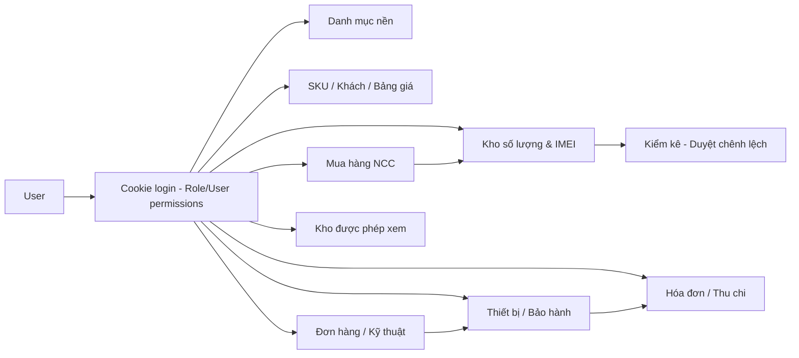
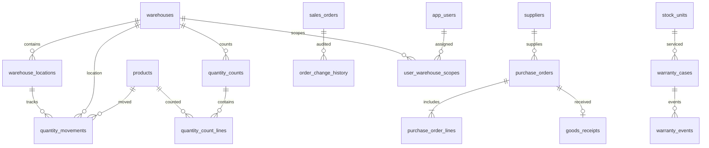

# Kiến trúc và quan hệ database TNM v6

## Luồng màn hình

## Quan hệ chính

## Ảnh chụp và sổ phát sinh

- `stock_count_batches` / `stock_count_lines`: ảnh chụp nguồn Excel, không sinh tồn vật lý.
- `quantity_movements`: sổ tồn số lượng **đang vận hành**, khóa SKU + kho + vị trí.
- `stock_units`: theo từng IMEI, không cộng trùng với `quantity_movements`.
- `quantity_counts` / `quantity_count_lines`: phiên kiểm kê vận hành thực tế, duyệt sinh bút toán ADJUST.
- `audit_logs`: ghi người tác động các tác vụ v6.
- `schema_versions`: đánh dấu khởi tạo schema lần đầu ở v6. Chưa phải engine migrations tự động.

## Phân quyền

Cơ chế User + Role + Allow/Deny riêng. Kho SELECTED: cho phép trang `/quantity-stock`, `/quantity-counts`, `/purchases` với query/mutation lọc phía server, chặn các trang kho/phụ thuộc kho cũ không có data scope. ADMIN luôn xem được toàn bộ. Không có phân quyền theo khách hàng/chi nhánh trên toàn ứng dụng trong bản này.
